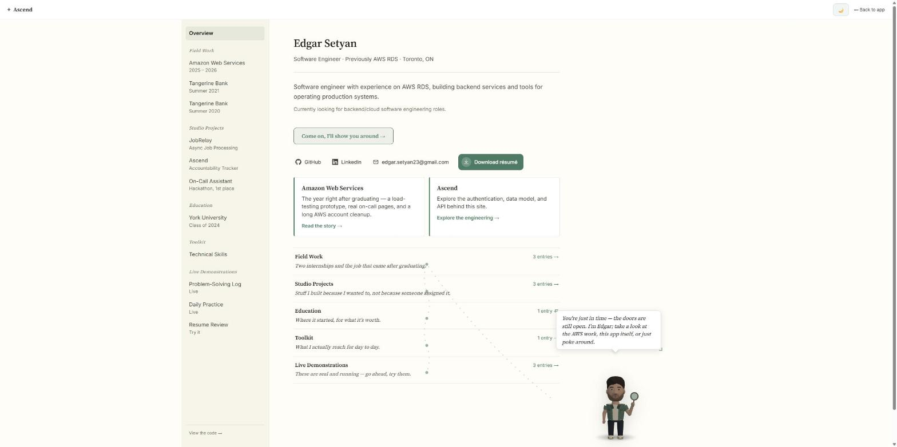
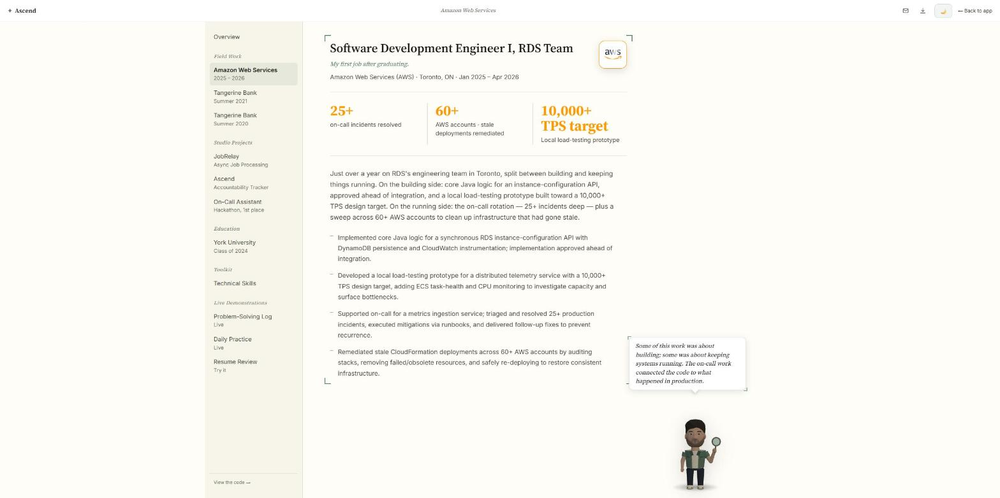
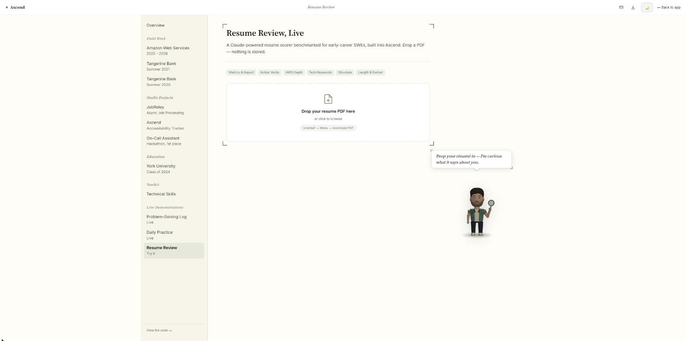
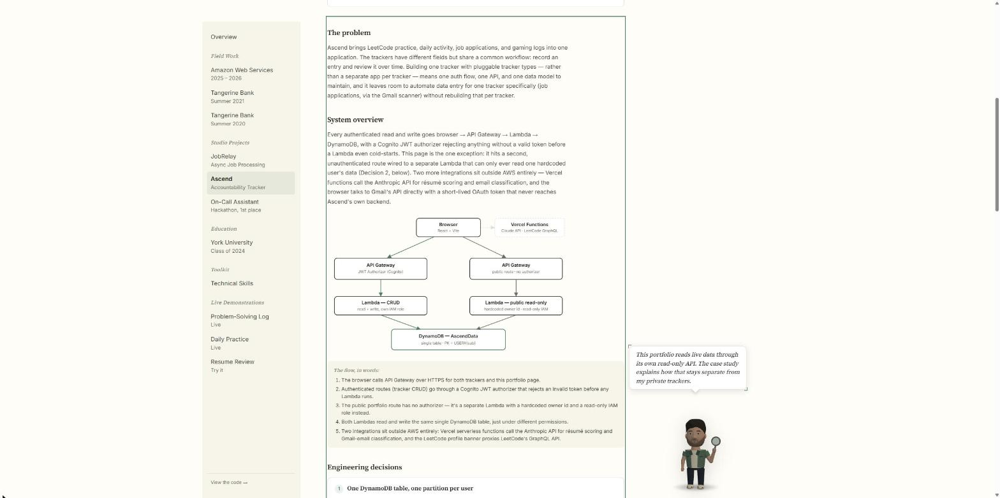
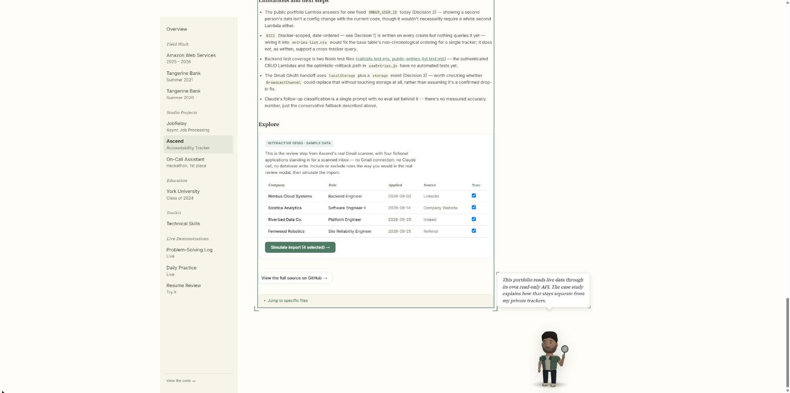
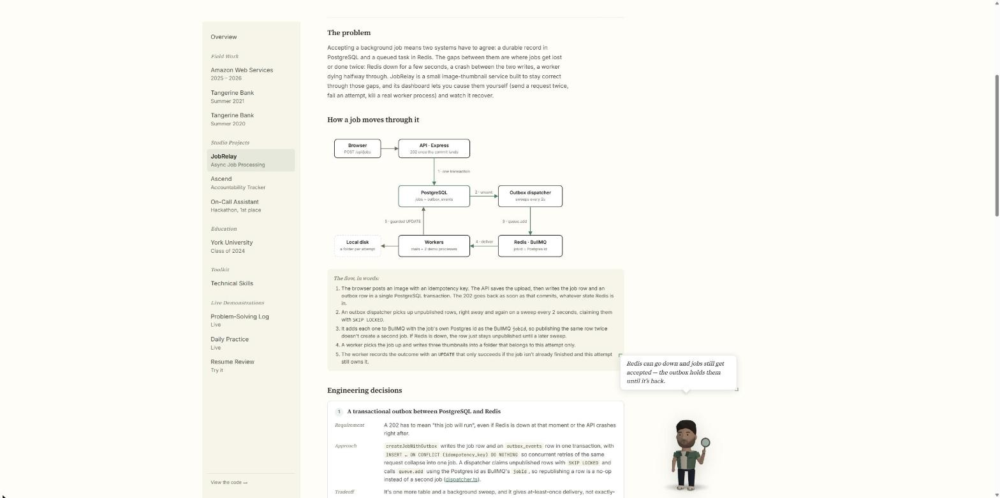

# Ascend

Ascend is a tracker for job applications, LeetCode practice, daily activity, and gaming sessions. It also hosts my public portfolio, where visitors can see selected tracker data without signing in.

The tracker and portfolio share an AWS backend. The Gmail importer helps fill in the Jobs tracker, and the portfolio has a PDF resume review tool. Those two features use Claude Haiku 4.5 through Vercel functions.

[Open Ascend](https://edgarsetyan.com) | [View the portfolio](https://edgarsetyan.com/portfolio)

<p>
  
  
  
</p>
<p>
  
  
  
</p>

## What you can try

The public portfolio is available without an account. The Ascend project page includes a walkthrough of the backend and a small Gmail-import demo with fictional applications. The demo runs locally in the browser; it doesn't connect to Gmail or save entries.

The signed-in app has four trackers with editable entries. For Jobs, the Gmail scanner searches up to 50 matching messages from the last 90 days and reads their headers and snippets. It suggests new applications and status changes, then lets you review them before saving. Full email bodies and attachments aren't fetched.

The resume tool extracts text from a PDF in the browser and sends the extracted text for scoring across six categories. The score is feedback from a model, not a prediction of hiring outcomes.

## How it works

```text
React + Vite
  |
  +-- API Gateway
  |     +-- Cognito JWT authorizer -> private tracker Lambdas -> DynamoDB
  |     +-- Public read-only Lambda -> owner's LeetCode and Activity entries
  |
  +-- Vercel functions
  |     +-- /api/leetcode-stats -> LeetCode GraphQL
  |     +-- /api/scan-emails -> Claude Haiku 4.5
  |     +-- /api/analyze-resume -> Claude Haiku 4.5
  |
  +-- Gmail API (called by the browser after Google OAuth)
```

The frontend is React 18 with Vite and React Router. AWS CDK in `infra/` defines the Cognito pool, HTTP API, Node.js Lambdas, and DynamoDB table. Vercel hosts the frontend and the three API proxies above.

A tracker entry has a partition key of `USER#{sub}` and a sort key of `TRACKER#{trackerId}#ENTRY#{uuid}`. The private handlers get `sub` from the verified JWT, rather than accepting a user ID from the request. Listing a tracker uses a key query and follows DynamoDB pagination.

## A few implementation choices

- **DynamoDB fits the current reads.** The app mostly loads one user's entries for one tracker. That maps to a partition key and sort-key prefix. Reporting across trackers would need more work.
- **The public page has a separate handler.** Its Lambda has read-only table permissions, uses a configured owner ID, and only allows the LeetCode and Activity trackers. It doesn't reuse the private CRUD handler with authentication switched off.
- **Edits update the UI immediately.** `useEntries` sends the request in the background and rolls back the local change if it fails. This keeps routine edits responsive, but it isn't an offline sync system.
- **Gmail uses a new-tab OAuth flow.** The callback hands the token to the original tab through a storage event. This avoids the popup flow's COOP issue, at the cost of briefly putting the token in localStorage during the handoff.
- **AI results have a schema and a review step.** Both Claude calls use JSON Schema structured outputs. The server checks the returned fields and types, score bounds, category uniqueness, dates, and follow-up IDs. The weighted resume total is calculated in code. Email suggestions still need review because a valid response can misread an email.

These AI features each make one extraction or scoring request. They don't need a tool-execution loop. If a future feature lets the model choose and perform actions, strict tool use would be a better fit for those actions. See [Anthropic's structured output documentation](https://platform.claude.com/docs/en/build-with-claude/structured-outputs).

## Current limits

This is a personal app with a public portfolio attached. The public-data handler is configured for one owner, rather than a directory of public profiles.

The table has a tracker-specific date index, but the list handlers don't query it yet. The base sort key ends in a random UUID, so its order isn't creation-date order.

The AI endpoints currently have no authentication or application-level rate limiting. They need abuse controls before opening them to wider use. Resume feedback is subjective, and the Gmail scanner can miss messages outside its search terms or misclassify a snippet. Structured output handles response shape; it doesn't establish accuracy.

The Cognito SDK persists its session in localStorage. The Gmail handoff also uses localStorage briefly. Both depend on keeping scripts running on the app's origin trustworthy.

## Finding the code

| Path | Contents |
|---|---|
| `src/hooks/useEntries.js` | Tracker reads, writes, and optimistic updates |
| `src/lib/` | Cognito session and API clients |
| `src/trackers/` | Columns and defaults for each tracker |
| `src/components/EmailScanner.jsx` | Gmail scan and review flow |
| `src/components/ResumeReview.jsx` | PDF text extraction and scoring UI |
| `src/components/portfolio/` | Project walkthroughs and sample-data demos |
| `api/` | Vercel handlers and shared AI response validation |
| `infra/lambda/` | Tracker handlers and backend tests |
| `infra/lib/` | CDK resource definitions |

## Running locally

Use Node.js 22. For the tracker backend, you'll need an AWS deployment or access to an existing one. Copy the frontend configuration and fill in its values:

```sh
npm ci
cp .env.example .env.local
npm run dev
```

The Vite server serves the frontend. It does not run the Vercel functions in `api/`; those features need a Vercel-compatible runtime and `ANTHROPIC_API_KEY` configured server-side.

To provision your own AWS backend, install the infrastructure dependencies, configure AWS credentials, and bootstrap CDK for your account and region. Set `OWNER_USER_ID` in `infra/.env` for the public-data handler, using `infra/.env.example` as a template.

```sh
cd infra
npm ci
npx cdk deploy
```

Use the deployment outputs to fill in the frontend's API and Cognito settings. Google OAuth also needs its own client configuration; the setup is in [the Gmail scanner notes](docs/05-gmail-scanner.md).

## Checks

```sh
npm test
npm run build
npm --prefix infra test
```

The frontend suite includes mocked AI endpoint tests for successful responses and rejected output. It doesn't call Claude. A passing test suite doesn't verify live AWS, Gmail, or Anthropic credentials.

## Configuration

| Variable | Where | Purpose |
|---|---|---|
| `VITE_API_URL` | `.env.local` + Vercel | AWS API Gateway base URL |
| `VITE_COGNITO_REGION` | `.env.local` + Vercel | AWS region |
| `VITE_USER_POOL_ID` | `.env.local` + Vercel | Cognito User Pool ID |
| `VITE_USER_POOL_CLIENT_ID` | `.env.local` + Vercel | Cognito App Client ID |
| `VITE_GOOGLE_CLIENT_ID` | `.env.local` + Vercel | Google OAuth Client ID |
| `ANTHROPIC_API_KEY` | Vercel only | Claude API — never in browser bundle |
| `OWNER_USER_ID` | `infra/.env` | Cognito sub baked into public Lambda at deploy time |

See `.env.example` and `infra/.env.example` for templates.

## More detail

- [Architecture](docs/01-architecture.md): data model, authentication, and deployment
- [Public portfolio](docs/03-recruiter-layer.md): public route and portfolio components
- [Gmail scanner](docs/05-gmail-scanner.md): OAuth, message fetching, and import review
